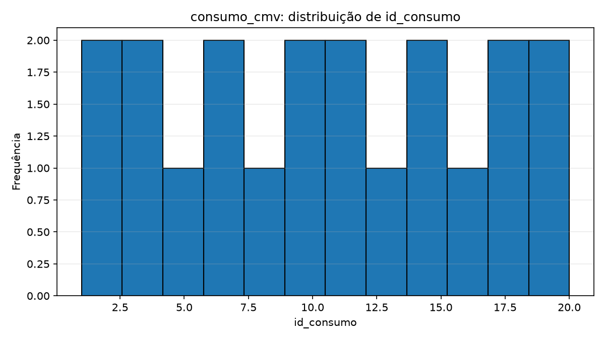
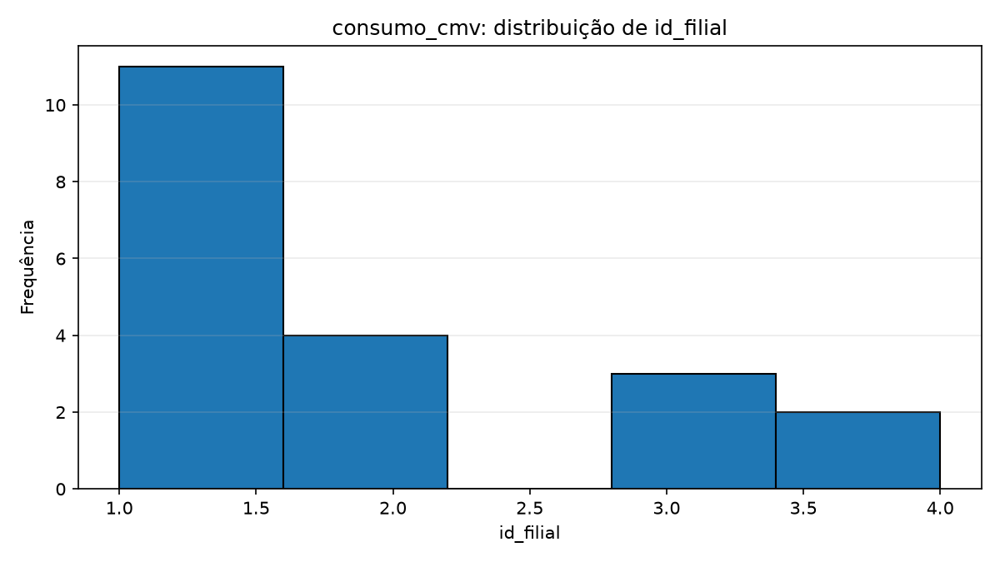
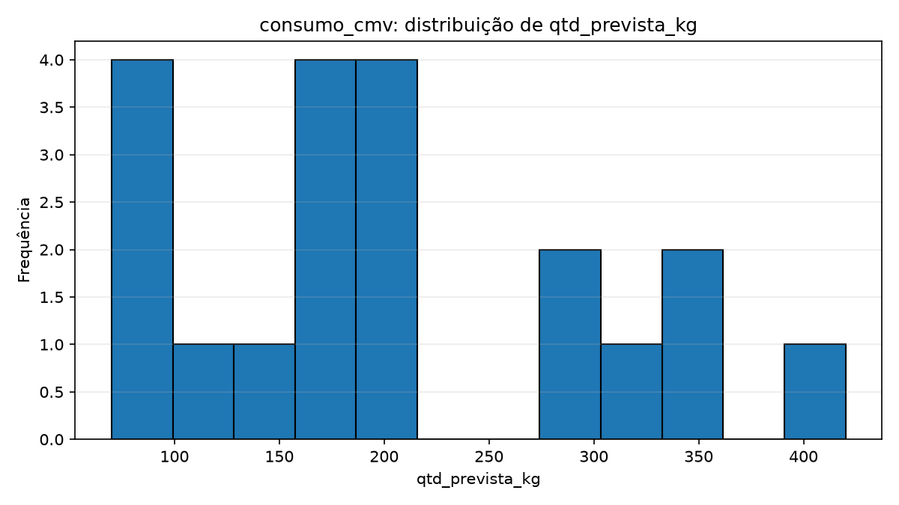
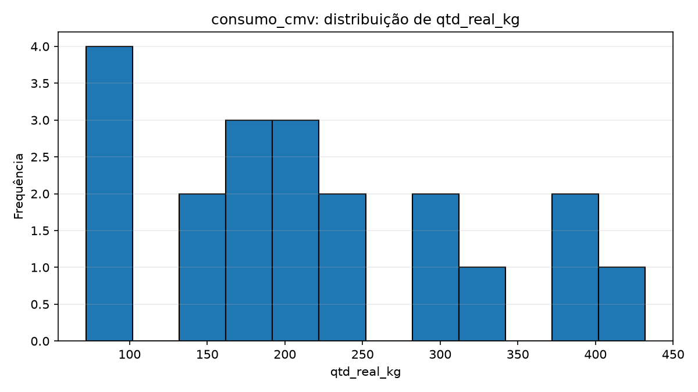

# EDA — Consumo Cmv

## 1. Escopo
Arquivo analisado: `gastrocore_consumo_cmv_silver.csv`.
Análise exploratória descritiva da camada Silver. A base original não foi modificada.

## 2. Diagnóstico estrutural
- Registros: **20**
- Colunas: **17**
- Valores ausentes: **0**
- Linhas integralmente duplicadas: **0**

### Valores ausentes por variável
_Sem registros para apresentar._

## 3. Estatísticas descritivas — variáveis numéricas
| variavel               |   count |      mean |       std |    min |      25% |      50% |       75% |      max |
|:-----------------------|--------:|----------:|----------:|-------:|---------:|---------:|----------:|---------:|
| id_consumo             |      20 |   10.5    |    5.9161 |   1    |    5.75  |   10.5   |   15.25   |    20    |
| id_filial              |      20 |    1.8    |    1.0563 |   1    |    1     |    1     |    2.25   |     4    |
| qtd_prevista_kg        |      20 |  204      |   99.8631 |  70    |  125     |  185     |  282.5    |   420    |
| qtd_real_kg            |      20 |  220      |  105.964  |  72    |  147     |  194     |  297.5    |   432    |
| custo_unitario_kg      |      20 |   22.22   |   14.7215 |   4.8  |    6.95  |   21.9   |   36      |    44    |
| cmv_orcado_reais       |      20 | 5101.27   | 4399.56   | 455    |  904     | 4650     | 7575      | 15840    |
| cmv_realizado_reais    |      20 | 5478.17   | 4783.76   | 468    | 1000.1   | 4929.75  | 8138.62   | 17512    |
| desvio_cmv_reais       |      20 |  376.892  |  441.188  |  13    |   93.725 |  249.75  |  459      |  1672    |
| desvio_cmv_percentual  |      20 |    8.1395 |    5.5284 |   1.67 |    3.16  |    6.67  |   11.465  |    20    |
| fator_correcao_teorico |      20 |    1.164  |    0.1013 |   1    |    1.115 |    1.15  |    1.2125 |     1.35 |
| fator_correcao_real    |      20 |    1.2585 |    0.1554 |   1.02 |    1.165 |    1.235 |    1.3825 |     1.62 |

## 4. Perfil das variáveis categóricas
| variavel          |   categorias_distintas | categoria_mais_frequente                       |   frequencia |
|:------------------|-----------------------:|:-----------------------------------------------|-------------:|
| data_competencia  |                      4 | 2026-03-01                                     |           12 |
| nome_filial       |                      4 | Cozinha Central Recife Antigo                  |           11 |
| categoria_insumo  |                      8 | Hortifruti                                     |            6 |
| nome_insumo       |                     17 | Acem Bovina em Cubos                           |            2 |
| classificacao_abc |                      3 | Curva A                                        |           12 |
| motivo_desvio     |                     20 | Aquecimento prolongado gerou reducao de volume |            1 |

## 5. Verificações específicas
| verificacao                            |   registros_verificados |   divergencias |   maior_diferenca |   tolerancia |
|:---------------------------------------|------------------------:|---------------:|------------------:|-------------:|
| qtd_prevista_kg: valores negativos     |                      20 |              0 |               nan |         0    |
| qtd_real_kg: valores negativos         |                      20 |              0 |               nan |         0    |
| cmv_orcado_reais: valores negativos    |                      20 |              0 |               nan |         0    |
| cmv_realizado_reais: valores negativos |                      20 |              0 |               nan |         0    |
| desvio_cmv_reais: valores negativos    |                      20 |              0 |               nan |         0    |
| CMV realizado - CMV orçado = desvio    |                      20 |              0 |                 0 |         0.01 |

## 6. Gráficos

## 7. Interpretação e limitações
- Estatísticas e frequências descrevem somente os registros disponíveis nesta base.
- Amostras pequenas ou sintéticas não permitem generalização para toda a operação.
- Correlações são exploratórias e não demonstram causalidade.
- Regras de negócio, limites operacionais e semântica de campos devem ser confirmados pelo CESIC.
- Quantidades com unidades de medida diferentes não devem ser agregadas sem conversão validada.

## 8. Próximas verificações recomendadas
- Confirmar dicionário de dados, unidades de medida e regras de negócio.
- Validar chaves de negócio e relacionamentos com as demais tabelas.
- Confirmar períodos de referência antes de comparações entre bases.

---
Relatório gerado automaticamente pelo script `executar_eda.py`.