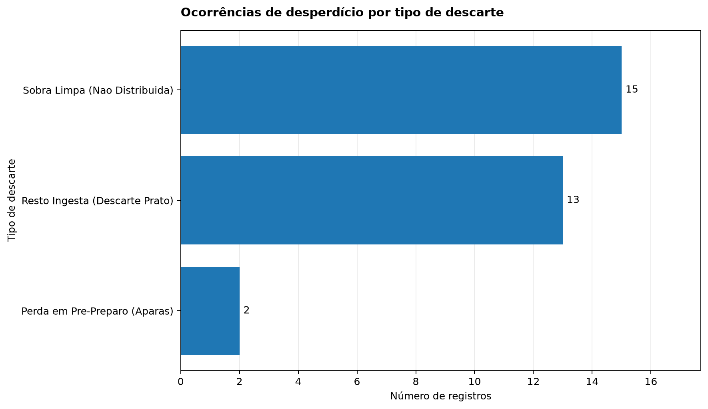
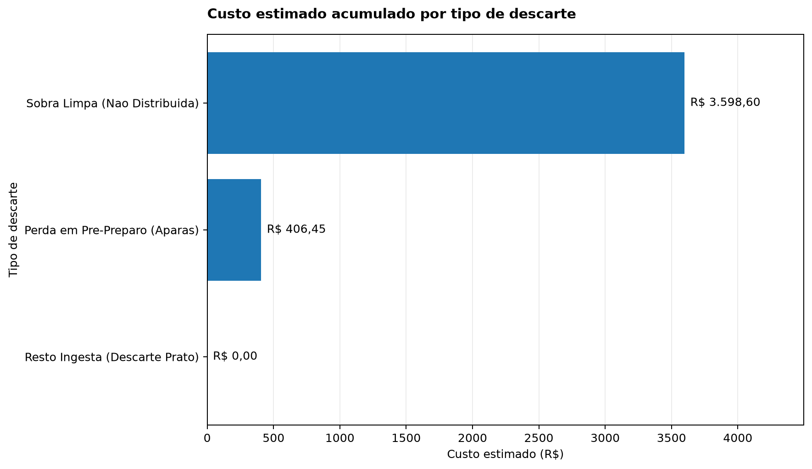
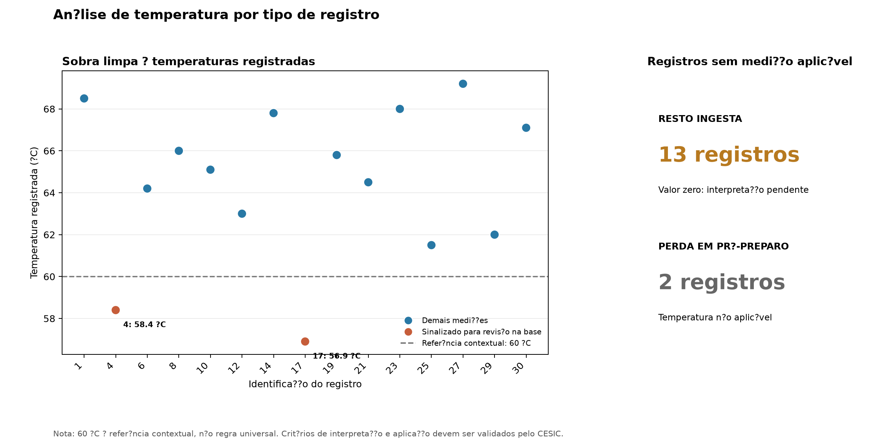

# EDA — Desperdicio

## 1. Escopo
Arquivo analisado: `gastrocore_desperdicio_rdc216_silver.csv`.
Análise exploratória descritiva da camada Silver. A base original não foi modificada.

## 2. Diagnóstico estrutural
- Registros: **30**
- Colunas: **16**
- Valores ausentes: **0**
- Linhas integralmente duplicadas: **0**

### Valores ausentes por variável
_Sem registros para apresentar._

## 3. Estatísticas descritivas — variáveis numéricas
| variavel                        |   count |      mean |      std |   min |     25% |     50% |       75% |     max |
|:--------------------------------|--------:|----------:|---------:|------:|--------:|--------:|----------:|--------:|
| id_registro                     |      30 |   15.5    |   8.8034 |   1   |   8.25  |   15.5  |   22.75   |   30    |
| id_filial                       |      30 |    2.0333 |   1.0662 |   1   |   1     |    2    |    3      |    4    |
| peso_kg                         |      30 |   28.3167 |  15.0469 |   8.5 |  15.825 |   24.9  |   39.625  |   58.4  |
| custo_estimado_reais            |      30 |  133.502  | 135.215  |   0   |   0     |  143.5  |  217.562  |  434    |
| refeicoes_produzidas_pax        |      30 | 1263.33   | 479.866  | 320   | 942.5   | 1120    | 1850      | 1920    |
| resto_ingesta_por_pax_gramas    |      30 |   15.1067 |  18.578  |   0   |   0     |    0    |   29.7725 |   56.88 |
| temp_afericao_celsius           |      30 |   33.47   |  32.0008 |   0   |   0     |   37.55 |   64.95   |   69.2  |
| indicador_temperatura_zero      |      30 |    0.4333 |   0.504  |   0   |   0     |    0    |    1      |    1    |
| indicador_temperatura_abaixo_60 |      30 |    0.0667 |   0.2537 |   0   |   0     |    0    |    0      |    1    |

## 4. Perfil das variáveis categóricas
| variavel                     |   categorias_distintas | categoria_mais_frequente           |   frequencia |
|:-----------------------------|-----------------------:|:-----------------------------------|-------------:|
| data_registro                |                      4 | 2026-03-01                         |           13 |
| nome_filial                  |                      4 | Cozinha Central Recife Antigo      |           12 |
| turno                        |                      3 | Almoco                             |           26 |
| tipo_descarte                |                      3 | Sobra Limpa (Nao Distribuida)      |           15 |
| status_sanitario             |                      4 | Conforme RDC 216                   |           13 |
| motivo_declarado             |                     29 | Indice controlado dentro do padrao |            2 |
| status_validacao_temperatura |                      4 | SEM_ALERTA_NA_REGRA_APLICADA       |           13 |

## 5. Verificações específicas
| verificacao                                                       |   registros_verificados |   divergencias | maior_diferenca   | tolerancia   |
|:------------------------------------------------------------------|------------------------:|---------------:|:------------------|:-------------|
| Temperatura igual a zero (investigar significado)                 |                      30 |             13 |                   |              |
| Temperatura positiva inferior a 60°C (investigar regra aplicável) |                      30 |              4 |                   |              |
| Registros marcados com indicador de temperatura zero              |                      30 |             13 |                   |              |

## 6. Gráficos

### Ocorrências por tipo de descarte

### Custo estimado por tipo de descarte

### Temperatura por tipo de registro

**Nota de interpretação:** valores iguais a zero estão identificados como pendentes de interpretação; registros de pré-preparo possuem temperatura não aplicável. A referência de 60 °C é contextual e não constitui classificação automática de irregularidade para todos os tipos de descarte. A regra aplicável deve ser confirmada pelo CESIC.

## 7. Interpretação e limitações
- Estatísticas e frequências descrevem somente os registros disponíveis nesta base.
- Amostras pequenas ou sintéticas não permitem generalização para toda a operação.
- Correlações são exploratórias e não demonstram causalidade.
- Regras de negócio, limites operacionais e semântica de campos devem ser confirmados pelo CESIC.
- Quantidades com unidades de medida diferentes não devem ser agregadas sem conversão validada.

## 8. Próximas verificações recomendadas
- Confirmar dicionário de dados, unidades de medida e regras de negócio.
- Validar chaves de negócio e relacionamentos com as demais tabelas.
- Confirmar períodos de referência antes de comparações entre bases.

---
Relatório gerado automaticamente pelo script `executar_eda.py`.