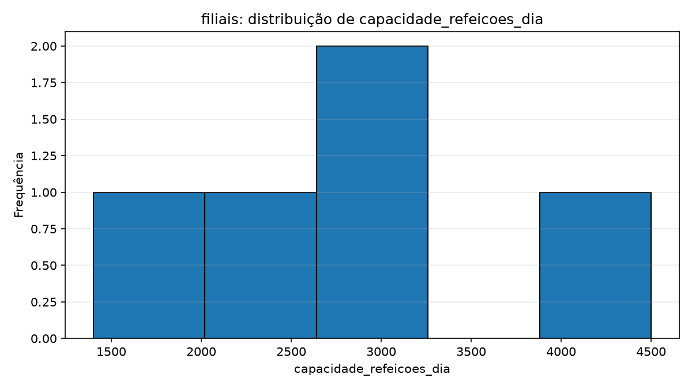
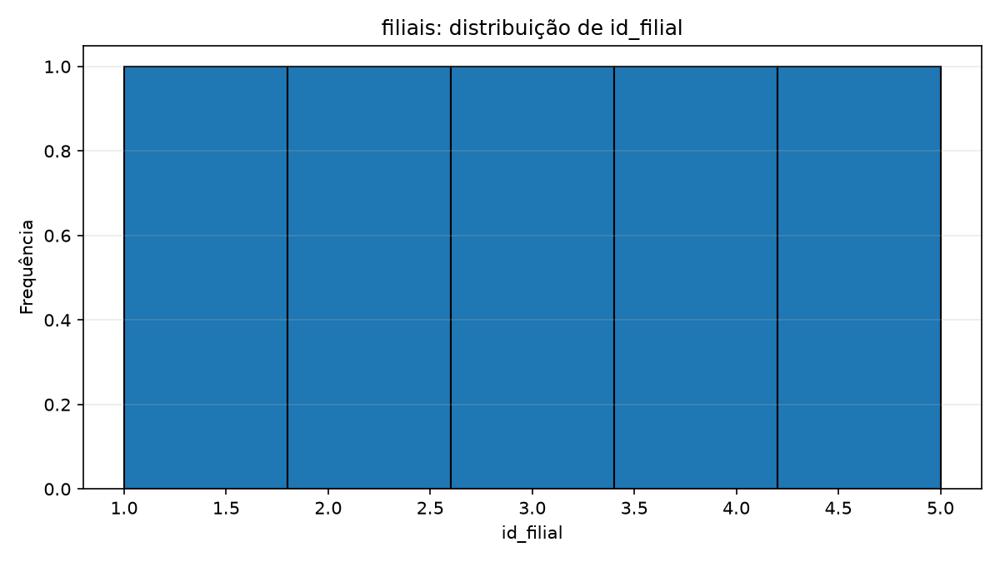
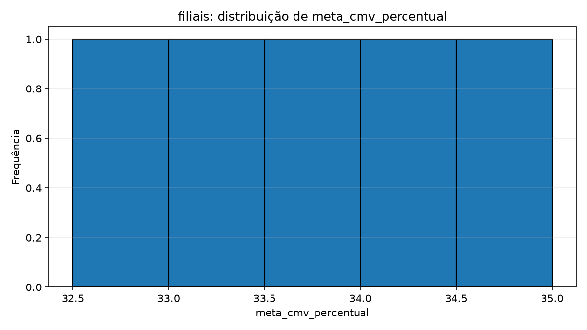

# EDA — Filiais

## 1. Escopo
Arquivo analisado: `gastrocore_filiais_pe_silver.csv`.
Análise exploratória descritiva da camada Silver. A base original não foi modificada.

## 2. Diagnóstico estrutural
- Registros: **5**
- Colunas: **11**
- Valores ausentes: **0**
- Linhas integralmente duplicadas: **0**

### Valores ausentes por variável
_Sem registros para apresentar._

## 3. Estatísticas descritivas — variáveis numéricas
| variavel                 |   count |   mean |       std |    min |   25% |    50% |   75% |   max |
|:-------------------------|--------:|-------:|----------:|-------:|------:|-------:|------:|------:|
| id_filial                |       5 |    3   |    1.5811 |    1   |     2 |    3   |     4 |     5 |
| capacidade_refeicoes_dia |       5 | 2800   | 1172.6    | 1400   |  2100 | 2800   |  3200 |  4500 |
| meta_cmv_percentual      |       5 |   33.6 |    0.9618 |   32.5 |    33 |   33.5 |    34 |    35 |

## 4. Perfil das variáveis categóricas
| variavel            |   categorias_distintas | categoria_mais_frequente                  |   frequencia |
|:--------------------|-----------------------:|:------------------------------------------|-------------:|
| codigo_unidade      |                      5 | FIL-CAR-03                                |            1 |
| nome_unidade        |                      5 | Cozinha Central Recife Antigo             |            1 |
| regiao              |                      5 | Agreste Central                           |            1 |
| cidade              |                      5 | Caruaru                                   |            1 |
| uf                  |                      1 | PE                                        |            5 |
| tipo_operacao       |                      5 | Cozinha Central (Produção & Distribuição) |            1 |
| responsavel_tecnica |                      5 | Dr. Rodrigo Bezerra (CRN-6 9340)          |            1 |
| status_operacional  |                      1 | Ativa                                     |            5 |

## 5. Verificações específicas
_Sem registros para apresentar._

## 6. Gráficos

## 7. Interpretação e limitações
- Estatísticas e frequências descrevem somente os registros disponíveis nesta base.
- Amostras pequenas ou sintéticas não permitem generalização para toda a operação.
- Correlações são exploratórias e não demonstram causalidade.
- Regras de negócio, limites operacionais e semântica de campos devem ser confirmados pelo CESIC.
- Quantidades com unidades de medida diferentes não devem ser agregadas sem conversão validada.

## 8. Próximas verificações recomendadas
- Confirmar dicionário de dados, unidades de medida e regras de negócio.
- Validar chaves de negócio e relacionamentos com as demais tabelas.
- Confirmar períodos de referência antes de comparações entre bases.

---
Relatório gerado automaticamente pelo script `executar_eda.py`.