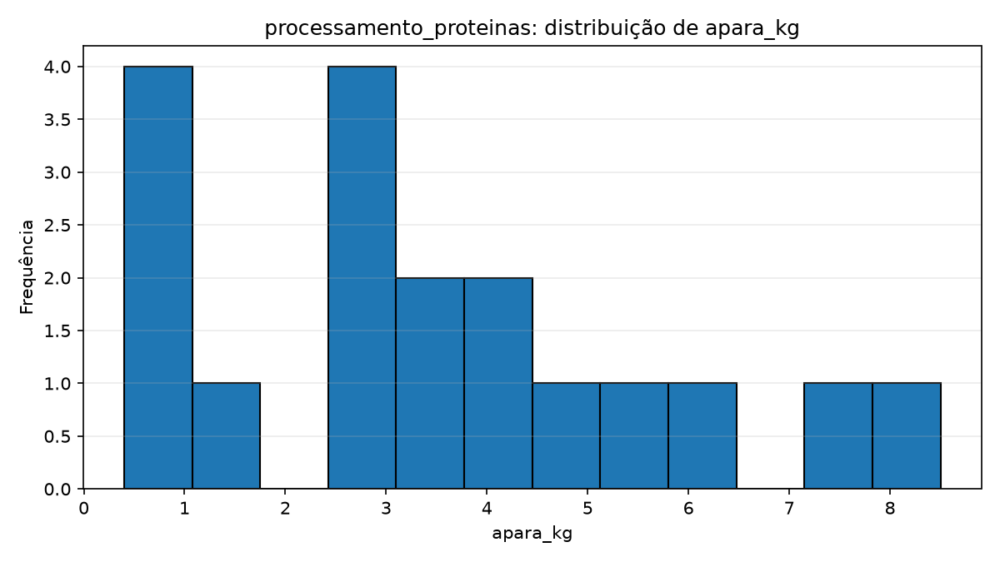
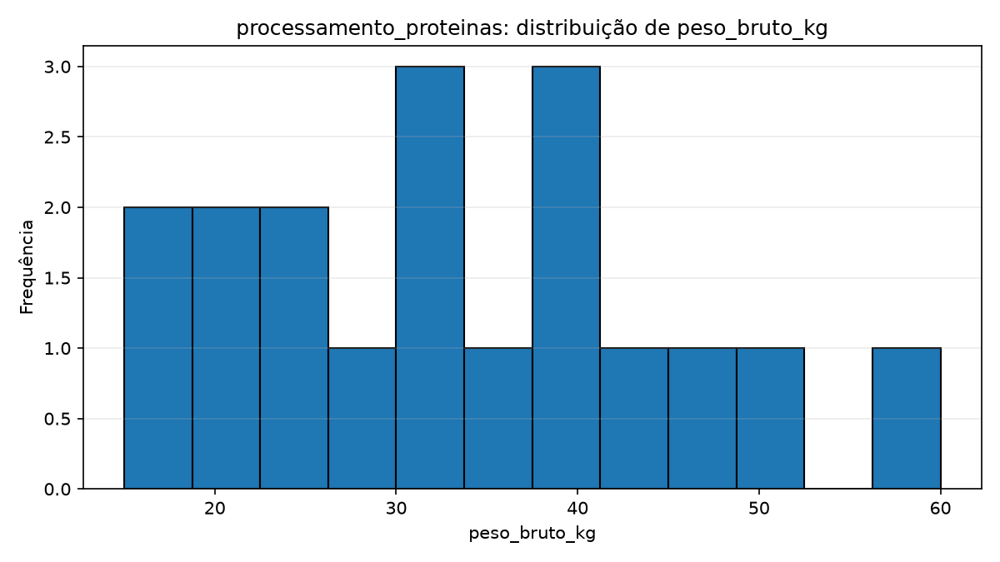
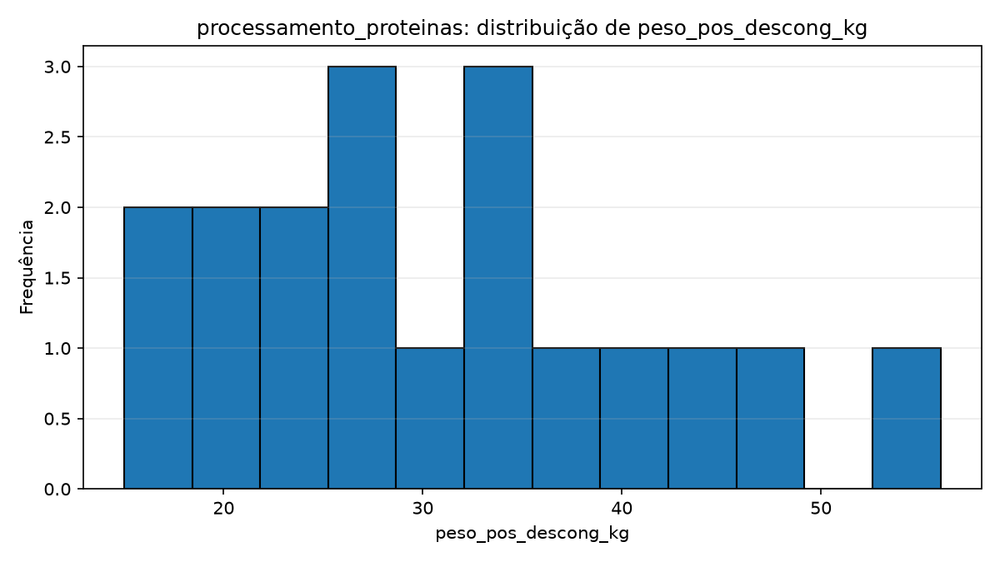
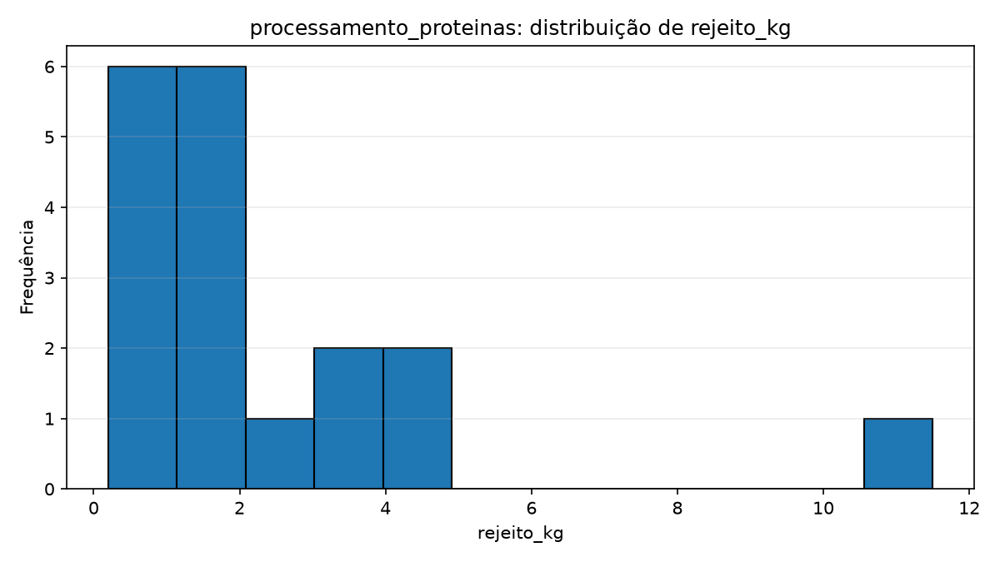

# EDA — Processamento Proteinas

## 1. Escopo
Arquivo analisado: `gastrocore_processamento_proteinas_silver.csv`.
Análise exploratória descritiva da camada Silver. A base original não foi modificada.

## 2. Diagnóstico estrutural
- Registros: **18**
- Colunas: **17**
- Valores ausentes: **0**
- Linhas integralmente duplicadas: **0**

### Valores ausentes por variável
_Sem registros para apresentar._

## 3. Estatísticas descritivas — variáveis numéricas
| variavel                  |   count |    mean |     std |   min |    25% |    50% |     75% |   max |
|:--------------------------|--------:|--------:|--------:|------:|-------:|-------:|--------:|------:|
| peso_bruto_kg             |      18 | 33      | 11.8768 | 15    | 24.25  | 31     | 40      | 60    |
| peso_pos_descong_kg       |      18 | 30.9278 | 11.0428 | 15    | 22.75  | 29.95  | 36.425  | 56    |
| apara_kg                  |      18 |  3.3333 |  2.3565 |  0.4  |  1.45  |  3     |  4.575  |  8.5  |
| rejeito_kg                |      18 |  2.2722 |  2.6006 |  0.2  |  0.775 |  1.6   |  2.85   | 11.5  |
| peso_limpo_kg             |      18 | 25.3222 |  7.5263 | 13.5  | 19.275 | 26.3   | 31.575  | 38    |
| perda_total_kg            |      18 |  7.6778 |  5.5316 |  0.8  |  4.65  |  6.7   |  9.15   | 23    |
| perda_pct                 |      18 | 21.2572 |  9.2786 |  4    | 15.14  | 21.455 | 25.5325 | 38.33 |
| fator_correcao_real       |      18 |  1.2872 |  0.1574 |  1.04 |  1.18  |  1.27  |  1.345  |  1.62 |
| limite_perda_pct          |      18 | 21.4444 |  7.3021 |  5    | 16.5   | 23     | 25      | 35    |
| diferenca_limite_perda_pp |      18 | -0.1872 |  3.956  | -8.16 | -2.165 |  0     |  1.75   | 10    |

## 4. Perfil das variáveis categóricas
| variavel                |   categorias_distintas | categoria_mais_frequente   |   frequencia |
|:------------------------|-----------------------:|:---------------------------|-------------:|
| data_processamento      |                     11 | 2026-11-02                 |            2 |
| unidade_codigo          |                      3 | IND-01                     |            9 |
| turno                   |                      3 | almoco                     |           15 |
| tipo_proteina           |                      6 | BOVINA                     |            7 |
| nome_proteina           |                     16 | File de Frango Congelado   |            3 |
| status_perda            |                      3 | DENTRO_DA_META             |           10 |
| comparacao_limite_perda |                      3 | ABAIXO_DO_LIMITE           |            8 |

## 5. Verificações específicas
| verificacao                                            |   registros_verificados |   divergencias |   maior_diferenca |   tolerancia |
|:-------------------------------------------------------|------------------------:|---------------:|------------------:|-------------:|
| Peso bruto - peso limpo = perda total                  |                      18 |              0 |          0        |         0.01 |
| Pós-descongelamento - aparas - rejeitos = peso limpo   |                      18 |              0 |          0        |         0.01 |
| Percentual de perda recalculado (tolerância 0,01 p.p.) |                      18 |              0 |          0.004444 |         0.01 |

## 6. Gráficos

## 7. Interpretação e limitações
- Estatísticas e frequências descrevem somente os registros disponíveis nesta base.
- Amostras pequenas ou sintéticas não permitem generalização para toda a operação.
- Correlações são exploratórias e não demonstram causalidade.
- Regras de negócio, limites operacionais e semântica de campos devem ser confirmados pelo CESIC.
- Quantidades com unidades de medida diferentes não devem ser agregadas sem conversão validada.

## 8. Próximas verificações recomendadas
- Confirmar dicionário de dados, unidades de medida e regras de negócio.
- Validar chaves de negócio e relacionamentos com as demais tabelas.
- Confirmar períodos de referência antes de comparações entre bases.

---
Relatório gerado automaticamente pelo script `executar_eda.py`.