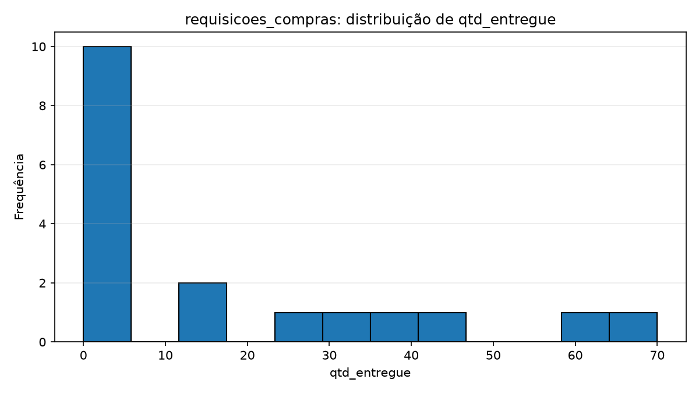
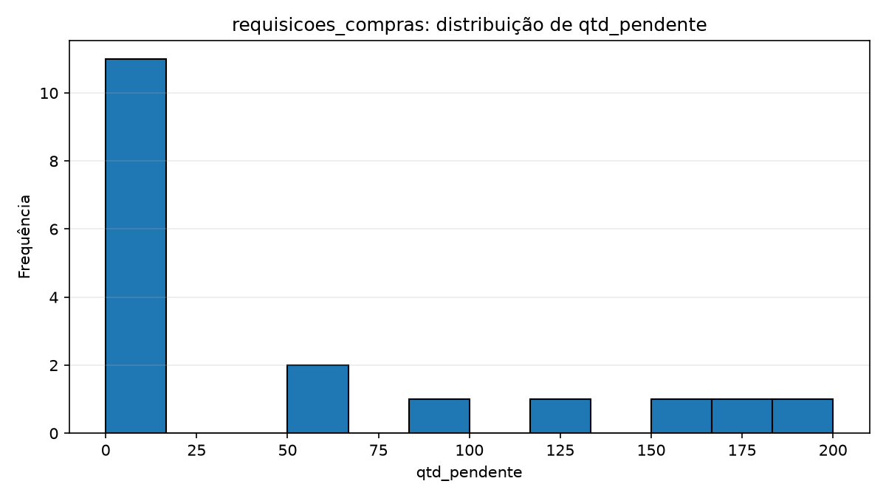
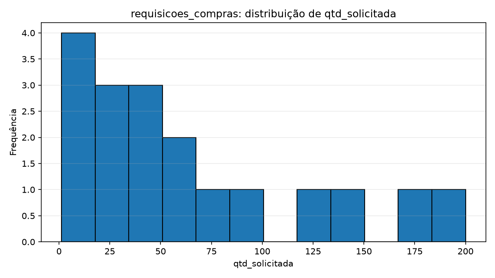
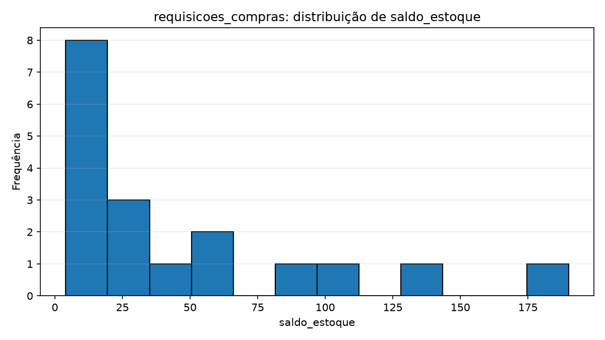

# EDA — Requisicoes Compras

## 1. Escopo
Arquivo analisado: `gastrocore_requisicoes_compras_silver.csv`.
Análise exploratória descritiva da camada Silver. A base original não foi modificada.

## 2. Diagnóstico estrutural
- Registros: **18**
- Colunas: **13**
- Valores ausentes: **0**
- Linhas integralmente duplicadas: **0**

### Valores ausentes por variável
_Sem registros para apresentar._

## 3. Estatísticas descritivas — variáveis numéricas
| variavel             |   count |     mean |       std |   min |    25% |   50% |     75% |   max |
|:---------------------|--------:|---------:|----------:|------:|-------:|------:|--------:|------:|
| saldo_estoque        |      18 |  46.9167 |   52.7821 |  4    |  10.5  |  23.5 |   62.5  |   190 |
| qtd_solicitada       |      18 |  65.3444 |   60.6311 |  1.2  |  21.25 |  47.5 |   87.5  |   200 |
| qtd_entregue         |      18 |  17.1222 |   22.8491 |  0    |   0    |   3   |   28.75 |    70 |
| qtd_pendente         |      18 |  48.2222 |   69.3555 |  0    |   0    |   3.5 |   82.5  |   200 |
| valor_unit_estimado  |      18 |  20.2111 |   20.2957 |  4.45 |   7    |  14.1 |   20.85 |    89 |
| valor_total_estimado |      18 | 993.748  | 1083.36   | 17.76 | 245.25 | 589.5 | 1216.5  |  3948 |

## 4. Perfil das variáveis categóricas
| variavel         |   categorias_distintas | categoria_mais_frequente   |   frequencia |
|:-----------------|-----------------------:|:---------------------------|-------------:|
| tipo_movimento   |                      3 | requisicao_estoque         |            8 |
| data_solicitacao |                     11 | 2026-11-02                 |            3 |
| unidade_codigo   |                      3 | IND-01                     |            9 |
| turno            |                      3 | almoco                     |            9 |
| categoria_item   |                      2 | SECOS                      |           11 |
| nome_item        |                     15 | Acucar Cristal 1kg         |            2 |
| unidade_medida   |                      4 | KG                         |           14 |

## 5. Verificações específicas
| verificacao                                                   |   registros_verificados |   divergencias |   maior_diferenca |   tolerancia |
|:--------------------------------------------------------------|------------------------:|---------------:|------------------:|-------------:|
| Solicitada = entregue + pendente                              |                      18 |              0 |                 0 |         0.01 |
| Quantidade solicitada x valor unitário = valor total estimado |                      18 |              0 |                 0 |         0.02 |

## 6. Gráficos

## 7. Interpretação e limitações
- Estatísticas e frequências descrevem somente os registros disponíveis nesta base.
- Amostras pequenas ou sintéticas não permitem generalização para toda a operação.
- Correlações são exploratórias e não demonstram causalidade.
- Regras de negócio, limites operacionais e semântica de campos devem ser confirmados pelo CESIC.
- Quantidades com unidades de medida diferentes não devem ser agregadas sem conversão validada.

## 8. Próximas verificações recomendadas
- Confirmar dicionário de dados, unidades de medida e regras de negócio.
- Validar chaves de negócio e relacionamentos com as demais tabelas.
- Confirmar períodos de referência antes de comparações entre bases.

---
Relatório gerado automaticamente pelo script `executar_eda.py`.